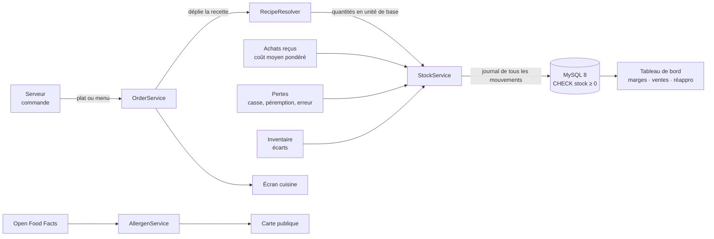

<p align="center">
  
</p>

<h1 align="center">Resto Manager</h1>

<p align="center">
  <b>De la carte aux achats, un seul outil pour un restaurant de 60 couverts.</b><br>
  Prise de commande en salle, écran cuisine, stocks qui se décrémentent tout seuls, marge réelle de chaque plat, et allergènes affichés sur la carte grâce à Open Food Facts.
</p>

<p align="center">
  
  
  
  
  
</p>

> **PFE Challenge EMC, sujet 2** : *Gestion d'un restaurant : carte, cuisine et stocks.*
> Les 5 niveaux sont traités. Données de démonstration : un restaurant de cuisine marocaine à Agadir, prix en MAD.

---

##  Démarrage en 1 commande

```bash
git clone https://github.com/sofiastron/prj.git resto-manager
cd resto-manager
docker compose up --build        # puis http://localhost:8080
```

Le conteneur installe les dépendances, attend MySQL, applique les migrations et charge les données de démo. Rien d'autre à configurer. Installation locale, dépannage : **[INSTALL.md](INSTALL.md)**.

| Rôle | Compte | Mot de passe | Arrive sur |
|---|---|---|---|
| Gérant | `gerant@resto.test` | `password` | tableau de bord + tout le back-office |
| Cuisine | `cuisine@resto.test` | `password` | file de cuisine, pertes |
| Serveur | `serveur@resto.test` | `password` | plan de salle, prise de commande |

La **carte publique avec allergènes** est visible sans connexion : <http://localhost:8080/carte>

---

##  Parcours de démo (5 minutes)

1. **Serveur** : deux tables (T3, T5) ont déjà une commande ouverte. Ajoutez un plat ou un menu. Un plat sans stock suffisant s'affiche *Indisponible* avec l'ingrédient manquant.
2. **Cuisine** (autre navigateur) : lancez un plat, marquez-le prêt. L'écran se rafraîchit seul.
3. **Serveur** : *Servir*, puis *Encaisser*.
4. **Gérant** : tableau de bord (marges, meilleures ventes, réapprovisionnement, puis « Créer le bon de commande »), réception d'un achat, inventaire avec écarts valorisés, bouton **↻ OFF** pour interroger Open Food Facts.

---

##  Ce qui rend ce projet intéressant

Le cœur du sujet est que **le stock doit rester juste**, même quand plusieurs personnes agissent en même temps. Tout part de là.



| Règle | Comment elle est garantie |
|---|---|
| **Le stock ne devient jamais négatif** | Refus applicatif, verrou `SELECT … FOR UPDATE` (ingrédients verrouillés dans l'ordre des id) et contrainte `CHECK` en base. |
| **Un plat devient indisponible dès qu'un ingrédient manque** | Disponibilité calculée en direct, avec l'ingrédient fautif affiché au serveur. |
| **Les préparations de base se réutilisent** (sauces, pâtes, fonds) | Dépliées récursivement par un seul composant, `RecipeResolver`. Les cycles sont interdits. |
| **Les unités sont propres** (g, kg, ml, cl, l, pièce) | Une unité de base par dimension, conversions via l'enum `Unit`, calculs exacts en `bcmath` (jamais de `float`). |
| **Le passé ne change pas** | Prix, TVA et coût matière sont figés sur la ligne de commande : si l'agneau double de prix, les marges d'hier ne bougent pas. |
| **Un menu n'est pas un plat** | Offre commerciale à prix fixe qui se résout en plats. Commande tout ou rien, prix réparti entre les plats. |
| **Pas de « sans allergène » sans preuve** | Trois statuts (`known`, `incomplete`, `unknown`) et un avertissement sur la carte quand l'information manque. |
| **Le stock ne se modifie que par achat, vente, perte ou inventaire** | Chaque variation a un mouvement, un auteur, un motif et un coût. |

Toutes les décisions et les réponses aux 5 questions de l'énoncé sont dans **[`docs/DECISIONS.md`](docs/DECISIONS.md)**.

---

##  Niveaux atteints

| Niveau | État | Où le voir |
|---|---|---|
| 1 — Modéliser | Fait | [`docs/MODELE.md`](docs/MODELE.md) (diagramme Mermaid), `migrations/`, `src/DataFixtures/` : 23 plats, 61 ingrédients, 6 fournisseurs, 5 préparations dont une imbriquée, 2 menus, 14 jours d'historique ; back-office `/admin/*` |
| 2 — Règles | Fait | `src/Service/` ; 69 tests dans `tests/`, lancés et vérifiés |
| 3 — Produit | Fait | rôles serveur / cuisine / gérant, salle, cuisine, tableau de bord |
| 4 — API externe | Fait | Open Food Facts (code-barres), allergènes sur `/carte` ; testé sur réponses simulées |
| 5 — Livrer | Fait, exécuté | `Dockerfile`, `docker-compose.yml`, [`INSTALL.md`](INSTALL.md) |

##  Les écrans

| Écran | Qui | Ce qu'on y fait |
|---|---|---|
| `/tables` → `/orders/{id}` | Serveur | Plan de salle, une commande ouverte par table, plats et menus avec note, annulation, encaissement |
| `/kitchen` | Cuisine | File *à lancer / en préparation / prêts*, rafraîchissement automatique |
| `/kitchen/losses` | Cuisine, gérant | Déclaration des pertes motivées |
| `/dashboard` | Gérant | CA, marge brute, pertes, valeur du stock, meilleures ventes, marge par plat, réapprovisionnement groupé par fournisseur |
| `/admin/*` | Gérant | Plats, menus, préparations et recettes, ingrédients, fournisseurs, achats (réception), inventaires, mouvements, tables, utilisateurs |
| `/carte` | Public | Carte avec allergènes et avertissement si l'information est incomplète |

Sécurité : authentification par formulaire, rôles hiérarchiques (le gérant hérite des deux autres), CSRF sur tous les POST. Les règles métier violées deviennent des messages clairs, jamais des erreurs 500.

---

##  Tests

**69 tests** répartis en trois couches :

| Couche | Tests | Ce qui est vérifié |
|---|---|---|
| Unitaires | 34 | unités et décimaux, statuts de ligne, dépliage des recettes, client Open Food Facts (réponses simulées) |
| Intégration (MySQL) | 24 | décrément du stock, indisponibilité, menu tout ou rien, coût figé, pertes, achats et coût moyen, inventaire |
| Fonctionnels (HTTP) | 11 | accès par rôle, pages, parcours complet table → commande → cuisine → service → encaissement |

```bash
composer test:prepare            # crée et migre la base resto_test (une fois)
vendor/bin/phpunit
```

---

##  Structure

```
src/
  Entity/        modèle (plats, ingrédients, préparations, commandes, stocks, achats…)
  Enum/          unités, dimensions, allergènes, statuts
  Service/       règles métier : Stock, Order, Purchase, Inventory, RecipeResolver,
                 Availability, Allergen, OpenFoodFactsClient, Dashboard, Decimal
  Controller/    salle, cuisine, pertes, tableau de bord, carte, admin/
  DataFixtures/  jeu de démonstration
migrations/      schéma MySQL (contraintes CHECK)
tests/           Unit · Integration · Functional
docs/            MODELE.md · DECISIONS.md · note conceptuelle
```

---

##  Comment j'ai utilisé l'IA

Je suis plutôt développeur Java / Spring Boot et je découvrais Symfony. J'ai utilisé **Claude** pour comprendre le projet (l'énoncé, le domaine, le découpage en niveaux) et l'IDE **Antigravity** pour le codage : le code a été écrit en grande partie par l'agent IA de l'IDE, que j'ai piloté. Mon travail : fixer l'ordre des étapes, relire les choix de conception, lancer les tests et vérifier leurs résultats, demander des corrections et faire organiser la documentation. L'IA s'est trompée à certains endroits, par exemple en versionnant par erreur un lien `vendor/` dans Git ; cette erreur est corrigée dans un commit à part. Détails dans [`docs/DECISIONS.md`](docs/DECISIONS.md) et dans la note conceptuelle.

##  Ce que j'ai vérifié, et ce qu'il reste à valider

J'ai lancé la suite de tests et je l'ai vérifiée moi-même ; j'ai aussi exécuté `docker compose up`. Tous les fichiers PHP passent le contrôle de syntaxe avec PHP 8.3, et j'ai recompté les données de démo.

À valider : un **vrai appel à Open Food Facts** (le client est pour l'instant testé sur des réponses simulées au format documenté). Je ne versionne pas encore `composer.lock` (voir `docs/DECISIONS.md`).

##  Et avec plus de temps

Lots et DLC avec FIFO, production de préparations en lot, saisonnalité automatique de la carte, réception partielle des achats, addition partagée, impression des tickets, rafraîchissement temps réel (Turbo / Mercure), gestion avancée des utilisateurs, tests de concurrence multi-processus.

##  Documentation

- [`docs/MODELE.md`](docs/MODELE.md) — modèle de données (Mermaid) et choix
- [`docs/DECISIONS.md`](docs/DECISIONS.md) — journal des décisions, réponses aux 5 questions
- [`INSTALL.md`](INSTALL.md) — installation, comptes, dépannage