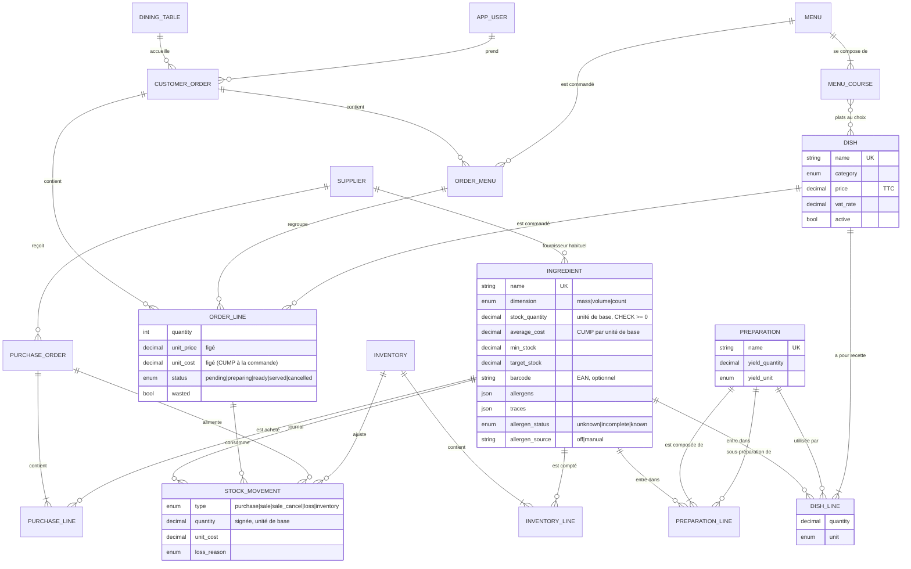

# Modèle de données

Schéma MySQL 8 géré par Doctrine (`migrations/`). Les entités sont dans `src/Entity/`, les énumérations dans `src/Enum/`.

## Vue d'ensemble

## Choix structurants

**Unité de base par dimension.** Chaque ingrédient a une *dimension* (masse, volume, pièces) ; son stock est toujours conservé dans l'unité de base de cette dimension (g, ml, pièce). Les recettes, achats, inventaires et pertes se saisissent dans n'importe quelle unité de la même dimension (kg, g, l, cl, ml, pce) et sont convertis (`Unit::toBase`). Une unité incompatible (des grammes de lait) est refusée. Cela évite toute ambiguïté dans les calculs et les comparaisons.

**Décimaux exacts.** Quantités et montants sont des `DECIMAL` MySQL, manipulés en PHP avec bcmath (`Service/Decimal`), jamais avec des `float`.

**Préparations de base = composants récursifs.** Une `Preparation` (sauce, pâte, fond…) a un rendement et ses propres lignes, qui peuvent référencer des ingrédients **ou d'autres préparations**. `DishLine` et `PreparationLine` désignent *exactement un* composant (contrainte CHECK en base et contrôle applicatif). `RecipeResolver` « déplie » la recette de façon proportionnelle au rendement pour obtenir les besoins en ingrédients bruts ; il détecte les cycles.

**Le stock est un cumul, le journal est la vérité d'audit.** `ingredient.stock_quantity` est la valeur courante (lecture rapide, contrainte `>= 0`) ; chaque variation passe par `StockService` qui écrit une ligne `stock_movement` signée (achat, vente, annulation, perte, inventaire) avec le coût du moment.

**Valeurs figées sur la commande.** `order_line` conserve nom du plat, prix TTC, TVA et coût matière *au moment de la commande*. L'historique et les marges réalisées ne bougent pas quand un prix change.

**Menu ≠ plat.** `Menu` → `MenuCourse` (temps) → plats au choix. Commander un menu crée un `OrderMenu` (prix de la formule figé) et une `OrderLine` par plat choisi ; le prix de la formule est réparti au prorata des prix à la carte.

**Allergènes sur l'ingrédient.** Chaque ingrédient porte ses allergènes, ses traces et un statut de fiabilité. L'allergène d'un plat est calculé en agrégeant ceux de ses ingrédients bruts (préparations dépliées).

## Intégrité en base

| Garde-fou | Où |
|---|---|
| `stock_quantity >= 0` | CHECK MySQL + contrôle applicatif |
| Une ligne de recette = un seul composant | CHECK MySQL + `RecipeResolver::assertLineValid` |
| Quantités de recette / de commande > 0 | CHECK MySQL |
| Noms uniques (ingrédient, plat, préparation, menu, table, e-mail) | index UNIQUE + `UniqueEntity` |
| Suppression d'un ingrédient/plat utilisé | `ON DELETE RESTRICT` |
| Une seule commande ouverte par table | verrou sur la table + contrôle dans `OrderService::open` |
| Un seul inventaire en cours | contrôle dans `InventoryService::start` |
